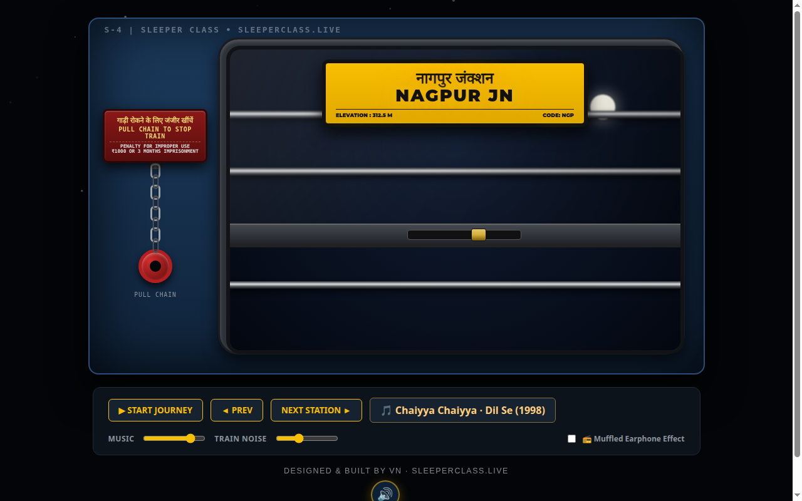

# SleeperClass.live 🚂🌙

## Screenshot




[](LICENSE)


A late-night Indian Railways sleeper-coach experience in a single HTML file. Settle into your berth as the train rumbles through the dark — passing stations glow by the window, you can pull the emergency chain (gently), and ride to a fixed radio of evergreen Bollywood train songs.

## Features

- 🚂 **Immersive sleeper coach** — window assembly, safety bars, glass shutter, control panel
- 🌃 **Passing stations** — glowing signboards roll by (Nagpur, Itarsi, Bhopal, Varanasi…)
- 🔊 **Procedural audio** — WebAudio-synthesized train rumble, ambient loops, and UI chimes (no audio files)
- ⛓️ **Emergency chain** — pull it and feel the brake (with a 3-second reset, don't worry)
- 📻 **Evergreen radio, seamless** — a fixed playlist of 90s & 2000s Bollywood train classics: Chaiyya Chaiyya (Dil Se), Kasto Mazza (Parineeta), Dhadak Dhadak (Bunty Aur Babli), Yun Hi Chala Chal (Swades) — one per station. Every track is pre-loaded in its own player, so switching stations crossfades instantly with no reload gap; if YouTube queues an ad on the next track, it plays out silently while your current song keeps playing
- 🎚️ **Mixing controls** — separate music / train-noise volume sliders, window latch, radio muffle
- ✨ **Maximalist night sky** — twinkling starfield, glowing signboard pulse, hover-glow controls
- ♿ **Reduced-motion respected** — calm static mode when your OS prefers it
- 🕛 **Journey clock + night phases** — the ride runs 23:40 → 05:00 (1 real second = 2 journey minutes while riding); the sky tint, moon arc, and phase label (Late Night → Deep Night → Pre-Dawn) follow the clock. Tap the clock to fast-forward 30 minutes
- 🚇 **Tunnel events** — every 45–90 seconds the train dives into a tunnel: the window darkens, tunnel lights strobe past, the rumble swells, then the night returns
- 🌧️ **Synthesized ambience layers** — toggle Rain (filtered noise + droplet plinks), Crickets (chirp bursts), and a Distant Horn (low two-tone swell), all generated live with WebAudio, no audio files
- 🎛️ **Atmosphere presets** — one click re-mixes the whole scene: Monsoon Night, Deep Sleep, Quiet Halt
- 🔗 **Share Journey** — copies a link (`#j=…`) that restores the station, mix, ambience layers, and clock for anyone who opens it
- 😴 **Sleep timer** — 15 / 30 / 60 minutes; the master bus fades out over the final 15 seconds, then the journey pauses
- 🔊 **Master limiter + perceptual volume curves** — a DynamicsCompressor catches stacked-layer peaks just below 0 dBFS; slider volumes use a squared curve so 50% sounds half as loud

## Controls

| Input | Action |
|---|---|
| **Start Journey** | Begin the ride (starts audio) |
| **Prev / Next Station** | Jump between stations |
| **Add Your Song** | Play a YouTube URL as the journey soundtrack |
| **Emergency chain** | Click-drag the chain down to pull it |
| **Sliders** | Mix music vs. train noise |
| 🔊 button (bottom-right) | Mute / unmute UI sounds |
| 🕛 clock (control panel) | Tap to fast-forward 30 journey-minutes |
| 🌧️🦗📯 Ambience chips | Toggle Rain / Crickets / Distant Horn layers |
| 🎛️ Atmosphere buttons | One-click mixes: Monsoon Night / Deep Sleep / Quiet Halt |
| 🔗 Share Journey | Copy a link that restores station + mix + clock |
| Sleep timer dropdown | Fade out over the final 15 s, then pause (15 / 30 / 60 min) |

## Tests

```bash
node --test tests/journey.test.js   # journey-clock / share-link pure helpers
```

The helpers are extracted from `index.html` and evaluated in a sandbox, so the
tests verify the shipped code. All inline `<script>` blocks also pass
`node --check`.

## Usage

No build step. Just open it:

```bash
# option 1: double-click index.html
# option 2: serve it
python3 -m http.server 8000
# → http://localhost:8000/index.html
```

> Browsers require a user gesture before audio can start — that's why the journey begins with the **Start Journey** button.

## Project structure

```
index.html      The entire app — markup, styles, and script in one file
assets/         Banner art
```

## How it was recovered

Fun fact: this app originally lived inside a LibreOffice `.odt` document (`index.html.odt`), which mangled the code on export — smart quotes, capitalized keywords (`Const`, `Function`), en-dashes as minus signs, and broken comments. The code was carefully extracted and repaired; see the QA notes in the repo history.

## License

MIT © 2026 Vivek Nair — see [LICENSE](LICENSE).

---

**Crafted by [Vivek Nair](https://github.com/vivekn4) · VN**
